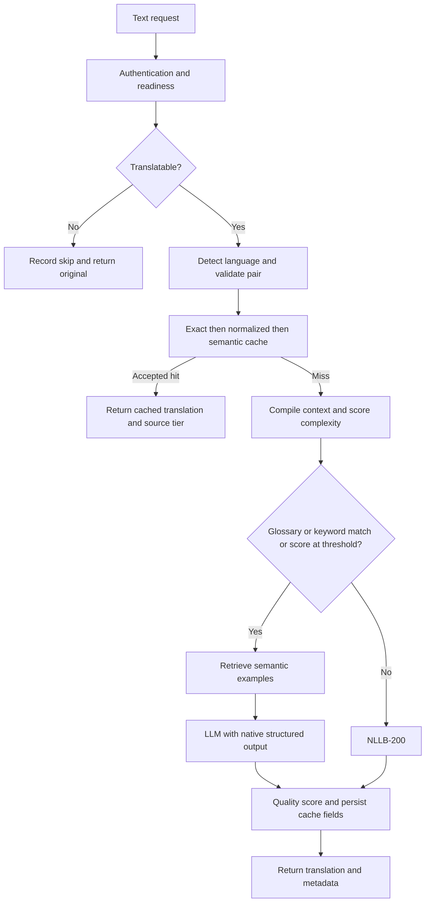

# Translation architecture and design

This guide describes the current code, including differences between text, URL-document, and bucket processing. Configuration values below are defaults from [config.py](../app/core/config.py); deployed environment values can override them.

## Components

| Component | Responsibility |
| --- | --- |
| FastAPI routers and Pydantic schemas | HTTP authentication/dependencies, validation, response envelopes, generated OpenAPI |
| Controllers | Coordinate context, cache lookup, model calls, persistence, and document/file workflows |
| Services and repositories | Database access, reusable units, brand/domain lookup, remote document and S3 access |
| `app/pipeline` | Verification, normalization, complexity, translation routing, embeddings, quality, AST handling, review |
| `app/llms` | Provider adapters, prompt templates, strict output schemas, semantic example retrieval |
| PostgreSQL + pgvector | Translation records, source embeddings, context records, bucket/file operation tracking |
| Duckling | Extract entities for normalization, such as numbers and dates |
| Readiness monitor | Check external services and load local models before accepting gated requests |

## Single-text pipeline

[TextTranslationController](../app/text_translation/controller.py) coordinates the path used by `/api/v1/translate`.

1. **Verification.** Blank/emoji-only input, URLs, paths, email addresses, usernames, numeric/currency strings, and strings consisting only of HTML tags are skipped. Mixed text containing HTML can still be translated. Skips are recorded without cache enrichment. For translatable input, `langdetect` supplies metadata; a detected-language mismatch does not currently reject the request. Requested pairs are limited to English in either direction with French, Spanish, Arabic, or Chinese.
2. **Cache lookup.** Try the tiers below before loading brand/domain context. Return an accepted hit with its stored score and complexity. Legacy rows without complexity trigger recomputation with context.
3. **Context.** Load brand context, merge matching reusable units into the glossary, and load domain rules. Reusable-unit entries overwrite matching glossary keys. The draft prompt consumes industry, summary, glossary, domain rules, and examples; stored tone/audience/entity fields are not separately injected into this prompt.
4. **Routing.** Compute complexity, retrieve examples when `routes_to_llm` selects the LLM, and invoke translation. The text controller replaces a supplied brand name with `{{BRAND_NAME}}` before translation and restores it afterward.
5. **Scoring and storage.** Successful nonempty outputs receive a reference-free cosine similarity score. The score initially populates both `score` and `trust_score`. Persist source/target text and languages, timing, sizes, success/error information, complexity, and optional filename/property. Source normalization produces hashes and an embedding for later retrieval. Quality failures leave a null score; embedding failures leave a null embedding.
6. **Return.** A fresh result reports `llm` or `machine_translation`. Failed engine calls are recorded and normally produce HTTP 502; unsupported operations follow the controller's separate error path.

## Cache reuse

[TranslationService](../app/text_translation/service.py) searches successful rows for the same source/target languages with `trust_score >= 0.85`. There is no engine filter: saved LLM and NLLB results are both eligible.

| Tier | Lookup | Additional acceptance rules | Response source |
| --- | --- | --- | --- |
| L1 | Original text equality or SHA-256 text hash | Prefer approved rows, then higher trust, then newer ID | `exact_cache` |
| L2 | SHA-256 of canonicalized, entity-abstracted source | Reject if the incoming text has extracted entities | `normalized_cache` |
| L3 | Nearest source embedding by pgvector cosine distance | Distance ≤ `0.02`; entity and negation checks below | `semantic_cache` |

Normalization applies Unicode NFKC, lowercasing, punctuation removal, and whitespace collapse after Duckling entities are replaced with placeholders. For example, “three” may become `{{NUMBER_0}}`, then `number_0` after canonicalization.

L3 examines only the nearest qualifying row. When the incoming text has entities, it re-extracts entities from the cached source and compares `(dimension, literal body)` in source order. Identical entities can pass despite shifted character offsets; changed or missing entities reject reuse. This is literal comparison, so equivalent spellings are not automatically treated as equal. The extra candidate extraction is currently conditional on incoming entities being present.

L3 also compares sets of negation words in normalized input and stored normalized text. The current word lists cover English, French, and Spanish. These checks reduce erroneous reuse but do not establish semantic equivalence for every language or sentence.

The lookup returns the stored translation unchanged: it does not replace entities in cached target text. A rejected nearest candidate ends L3 lookup; the service does not try additional candidates. An identical repeated request normally hits L1 before L3. Cache hits do not create a new enriched translation row.

## Semantic examples (RAG)

RAG uses the same stored source embeddings for a different purpose: supplying examples to a new LLM generation.

| Property | Semantic cache | LLM example retrieval |
| --- | --- | --- |
| Result | Reuse stored target text | Include source/target pairs in a prompt |
| Default distance limit | `0.02` | `0.4` (method argument) |
| Candidates requested | `1` | `3` per query |
| Trust filter | Configured threshold | None |
| Approval filter | Approval only ranks L1/L2; not required | None |
| Reported source | `semantic_cache` | `llm` for a fresh text generation |

RAG filters by language pair, successful status, and non-null embedding, orders by distance, and then filters the limited results by maximum distance. Records without translation text are omitted. Despite the helper's older “approved translations” wording, the query does not require approval or a trust threshold.

All text requests routed to the LLM retrieve examples, including low-complexity glossary/keyword matches. Retrieval errors are logged and yield an empty example list; generation can continue. Examples are guidance, not a guarantee that the model follows their terminology.

## Complexity and model responsibilities

[Complexity scoring](../app/pipeline/complexity.py) combines markup/placeholders, sentence length, vocabulary rarity, glossary/domain jargon, and a readability regression model, then clamps the heuristic score to 0–100. Short plain strings under 15 characters return zero. Vocabulary frequency currently uses English. Near the routing threshold (default ±8), an LLM rating is averaged with the heuristic score; a failed rating retains the heuristic score. Scores are cached in memory by text/context.

A case-insensitive substring match against glossary keys or brand keywords forces LLM routing regardless of score. Otherwise, scores ≥28 use the LLM and lower scores use NLLB.

| Purpose | Current model / mechanism |
| --- | --- |
| Local translation | `facebook/nllb-200-3.3B`; CUDA, then MPS, then CPU |
| Cache and RAG source embeddings | `all-MiniLM-L6-v2`, 384 dimensions |
| Source/output quality similarity | `intfloat/multilingual-e5-large`, cosine similarity, inputs truncated to 512 tokens |
| Readability | `v-urushkin/xlm-roberta-base-readability` |
| LLM generation and complexity rating | Configured Gemini, Ollama, or OpenRouter model |

Quality similarity is not a probability, human approval, or COMET score; its mathematical range is −1 to 1. It is distinct from source-to-source similarity used by cache retrieval.

LLM calls use `with_structured_output(..., method="json_schema")`. Single text requires a `translation` string. Batch schemas require exactly the supplied path keys with string values and forbid extras. Invalid output raises instead of falling back to raw text. Schema validity does not guarantee meaning, placeholder preservation, or translation quality. The active path does not run every summary/refinement/validation prompt defined in the repository.

## JSON documents

[DocumentTranslationController](../app/document_translation/controller.py) downloads JSON from a URL and constructs an AST of objects, arrays, text, and primitive values. It selects translatable strings, excluding `icon`/`icons` paths, and preserves structural paths such as `items[0].label`.

It partitions nodes using brand glossary/keywords and complexity computed with brand context:

- **Other nodes:** call the full text controller sequentially, including cache, reusable units, domain rules, scoring, and persistence. That controller may still decide to use an LLM after compiling its fuller context.
- **LLM nodes:** gather a path-to-text dictionary and translate it in one structured call. Retrieve up to three examples per distinct source string, sequentially on the shared database session, and deduplicate source/translation pairs across the batch.

The LLM batch receives brand context and examples. It currently bypasses text-cache reuse, reusable-unit context compilation, domain rules, brand-name placeholder substitution, per-node quality scoring, and per-node database persistence. There is no batch chunking or total example budget.

The output is reconstructed and checked for compatible object keys, array lengths, primitive types, and text paths. A segment or batch exception retains original source strings. Consequently, the endpoint can report completion with untranslated values; structural compatibility is not translation completeness.

## Buckets and CLI

[Bucket processing](../app/bucket_translation/controller.py) records an operation, lists `.json` files, and starts concurrent file tasks. A successful file record matched by source key, ETag/size fingerprint, and target language can copy the prior translated object; a failed copy falls back to translation. Otherwise it downloads JSON, builds the AST, translates each node through the full text controller, validates structure, and uploads JSON to the target prefix.

Files run concurrently; nodes within a file run sequentially. This path does not use URL-document LLM batching. It records per-file status and counters. `COMPLETED` means file processing finished, not that all files succeeded; inspect `failed_files` and file records. Segment fallback can also leave original text in a successful file. FastAPI background tasks run in the API process, with no durable worker queue or restart recovery.

The [CLI](../scripts/translate_json.py) also translates local JSON nodes through the text controller. See `python -m scripts.translate_json --help` for commands and options.

## Review and current limits

`POST /api/v1/review/start` schedules one review batch, not a recurring scheduler. The reviewer scans successful rows, fills missing complexity/trust values, and requests LLM correction when trust is **≤0.85** and complexity meets the configured threshold. The review cutoff is currently hard-coded independently of `TRUST_SCORE_THRESHOLD`. Changed outputs are rescored and marked verified; the code does not require the new score to exceed the old score. Review calls do not retrieve RAG examples.

Cache and RAG queries are scoped to language pairs, not brand/domain context or model/prompt version. A cache hit occurs before context compilation, so a changed brand profile does not invalidate an existing hit. Source embeddings use MiniLM rather than the multilingual quality model. Retrieval, entity checks, and quality scores should be evaluated for the actual language/content mix.

There is also a current brand lookup defect: `BrandService.get_brand_context` references `self._repo`, which the service does not initialize. Requests with a brand UUID can therefore fail before translation. This documentation records that limitation; it does not change the implementation.
